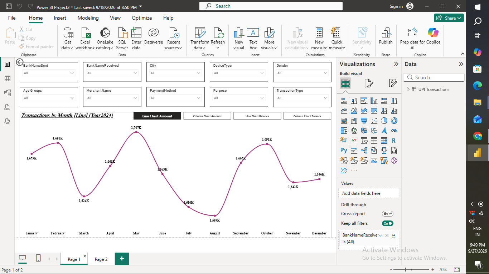
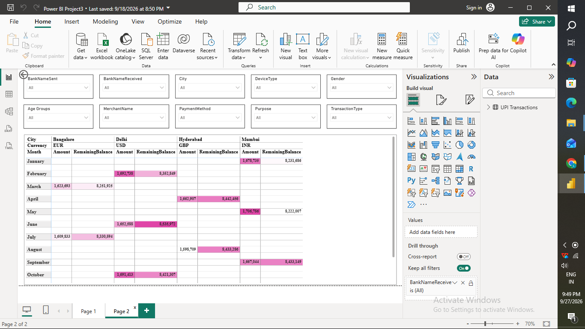

# Digital Payments (UPI Transactions) Dashboard (Power BI)

A 2-page Power BI dashboard analyzing a year of UPI/digital transaction data (amount, balance, bank, merchant, payment method, device, city, currency, demographics).

## Pages

**Page 1 – Transactions by Month** — Toggle buttons switch between Line/Column charts of Amount vs. Balance; 10 slicers for deep filtering (bank, city, device, gender, age, merchant, payment method, purpose, transaction type)

**Page 2 – City / Currency Breakdown** — Pivot table of Amount & Remaining Balance by City → Currency → Month, showing each city trades primarily in one currency

## Skills Practiced
- Bookmarks + action buttons for toggling visual states
- Multi-slicer filter panel (10 slicers) for granular filtering
- Pivot/matrix table with two-level column grouping
- Working with multi-currency, transactional/financial data
- Cross-filtering & "keep all filters" configuration

## File
`Power_BI_Project3.pbix` — open in Power BI Desktop
